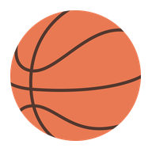
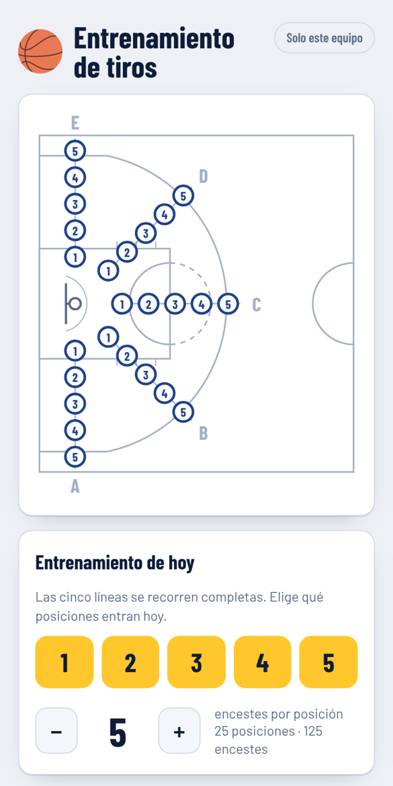
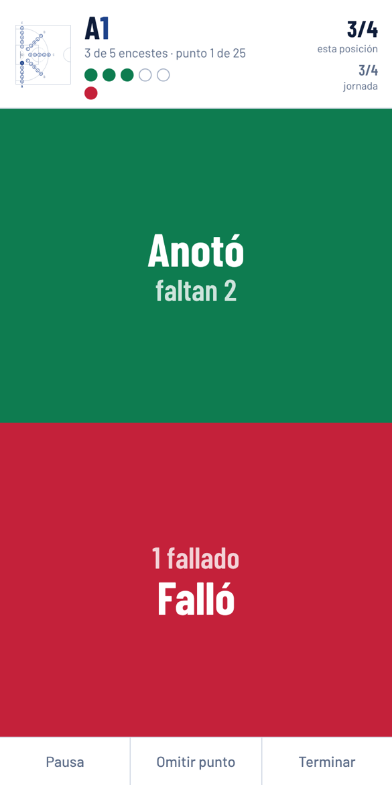
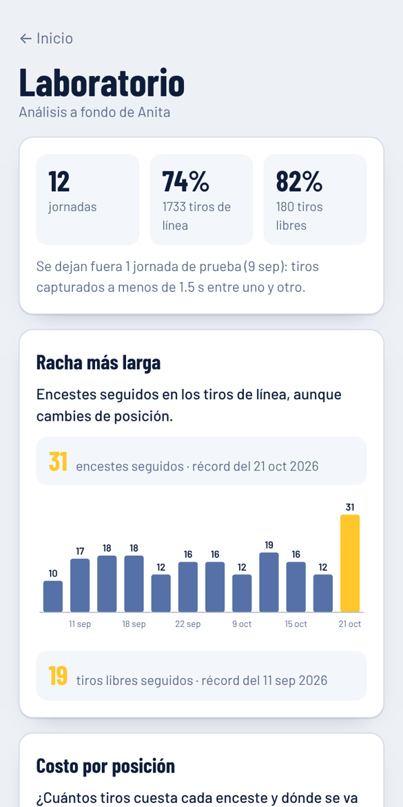
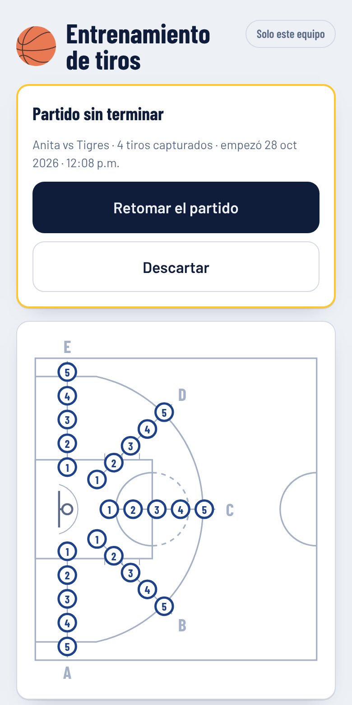
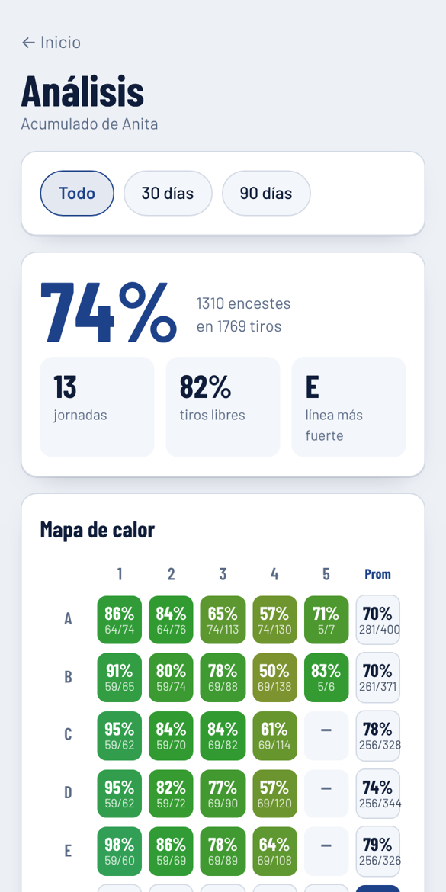
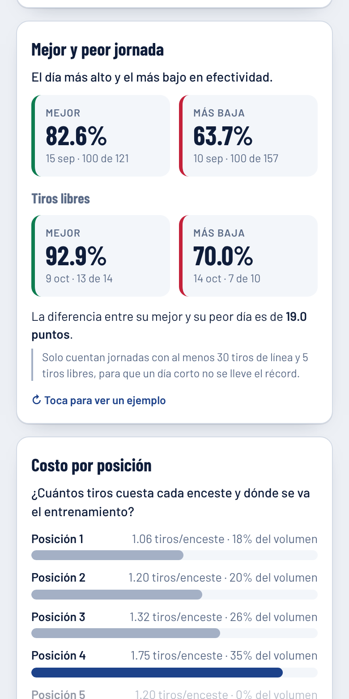
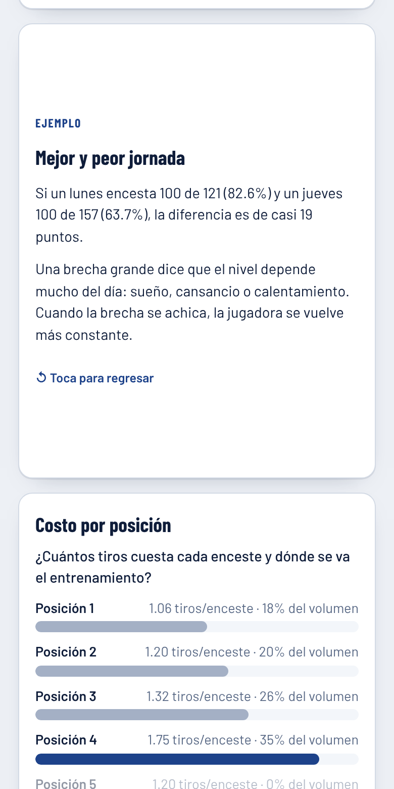

# Entrenamiento de tiros

**Registra cada tiro, mide cuánto cuesta cada enceste y descubre dónde mejorar.**

App para el celular que acompaña el entrenamiento de tiro en baloncesto: se captura con un dedo en plena cancha, funciona sin internet y convierte cada jornada en análisis que un entrenador usaría.

📱 Se instala como app &nbsp;·&nbsp; 📶 Funciona sin señal &nbsp;·&nbsp; ☁️ Respaldo en Google Drive &nbsp;·&nbsp; 👨‍👩‍👧 Varios jugadores

 

&nbsp;&nbsp;
&nbsp;&nbsp;

---

## 🏀 Cómo funciona el entrenamiento

La cancha se divide en **5 líneas (A a E)** y **5 posiciones (1 a 5)**: 25 puntos de tiro.

1. **Eliges las posiciones del día** y cuántos encestes pides en cada punto (por ejemplo, 5).
2. **La jugadora tira hasta lograr esos encestes** en cada punto. La app cuenta cuántos tiros le costó.
3. Al completar un punto, la app **avanza sola en 3 segundos** al siguiente. Puedes pasar de inmediato o quedarte ahí.
4. Al final vienen los **tiros libres**: se tira hasta lograr 10 encestes. Si quiere seguir tirando para buscar racha, esos tiros extra se miden aparte.

> 💡 Medir *cuántos tiros cuesta* un enceste, en lugar de cuántos entran de un número fijo, hace que cada punto se trabaje hasta dominarlo.

---

## ✋ Captura con un dedo

- Media pantalla **verde para "Anotó"** y media **roja para "Falló"**. No hay que ver el celular para atinarle.
- Arriba se ve el punto actual, los encestes que faltan y los círculos de cada intento.
- **Pausa**, **Omitir punto** y **Terminar** siempre a la mano.
- La pantalla se mantiene encendida durante la serie.
- Cada tiro guarda la hora exacta, así que la app sabe el **ritmo** al que se está tirando.

 

---

## 🏟️ Modo partido

Para los juegos de verdad, no solo la práctica:

- Tocas en la cancha **dónde fue el tiro** y si entró, fue bloqueado o hubo falta.
- Clasifica cada tiro en las **5 zonas estándar** (área restringida, pintura, media distancia, triple de esquina y triple sobre el arco), con medidas FIBA.
- Registra **rival, liga y periodo**, y calcula puntos, tiros de campo, triples, libres y asistencias.
- El resumen se puede ver por **partido**, por **liga** o con **todos sus partidos**.
- Puedes voltear la cancha al medio tiempo. El mapa se guarda siempre igual, así que el acumulado no se rompe.

### 🔁 Retomar el partido

Cada tiro se guarda en el teléfono **en el momento en que lo capturas**. Si el celular se apaga, se queda sin pila o la app se cierra a medio juego, no se pierde nada:

- Al abrir la app aparece arriba la tarjeta **Partido sin terminar**, con rival, tiros capturados y hora de inicio.
- **Retomar el partido** te regresa a la cancha con los tiros, el marcador y el periodo donde ibas.
- **Descartar** pide un segundo toque, para que no se borre por accidente.

 

---

## 📊 Análisis de cada jugador

Desde la pantalla principal, **Análisis de [jugador]** muestra solo a quien esté seleccionado en *¿Quién tira?*:

- 🎯 **Efectividad acumulada** en tiros de línea y tiros libres.
- 🗺️ **Mapa de calor** de los 25 puntos, con encestes y tiros reales de cada uno.
- 📏 **Por línea (A a E)** y **por posición (1 a 5)**, con barras para ver de un vistazo dónde es más fuerte.
- 📅 Filtros de **todo**, **últimos 30 días** y **últimos 90 días**.

 

---

## 🧑‍🏫 Coach: qué trabajar y cómo

El botón **Coach de [jugador]** convierte los números en un plan de entrenamiento. Revisa las últimas 6 jornadas y, para cada área de mejora, da:

- 📊 **El dato**: qué dicen sus números, con encestes y tiros reales.
- 🏋️ **El ejercicio**: qué hacer, cuántos tiros y en qué momento de la jornada.
- 🎯 **La meta**: un número concreto para saber si funcionó.

Arriba aparece el **Plan de la semana** con las 3 prioridades de mayor impacto, y al final **Lo que va bien**: sus puntos más fuertes y lo que ya domina.

| Regla | Se activa cuando… |
|---|---|
| 🎯 Posición más cara | Una posición está 8 puntos o más por debajo de la mejor. |
| 📐 Línea más débil | Una línea está 6 puntos o más por debajo de la mejor. |
| 🔋 Cansancio | Después del tiro 120 rinde menos que al principio, comparado con su nivel en cada punto. |
| 🧠 Después de un fallo | Tras fallar encesta menos, ya descontando el sesgo de "tirar hasta N encestes". |
| ⏱️ Ritmo | Los tiros apresurados entran menos que los pausados. |
| 🆓 Tiros libres | El primer libre falla más, el % está debajo de 75%, o ya está alto y toca subir la exigencia. |
| 🆚 Práctica contra partido | En el partido encesta 15 puntos o menos que en práctica. Pesa menos mientras haya pocos tiros de partido. |

> Las sugerencias se recalculan solas con cada jornada. Son una guía a partir de los números; el criterio del entrenador manda.

---

## 🧪 Laboratorio: el análisis a fondo

&nbsp;&nbsp;
&nbsp;&nbsp;

El botón **Laboratorio de [jugador]** responde las preguntas que un entrenador se hace y que no se ven a simple vista:

| | Módulo | La pregunta que responde |
|:-:|---|---|
| 🔥 | **Racha más larga** | ¿Cuántos encestes seguidos ha logrado, y cuándo? Tabla con la racha de cada jornada en tiros de línea (aunque cambie de posición) y en tiros libres. El récord de cada columna se marca con ★ y su fecha. |
| 🏆 | **Mejor y peor jornada** | ¿Cuál fue su día más alto y el más bajo, y qué tan lejos están? En tiros de línea y en libres, con fecha y tiros reales. Solo cuentan jornadas con al menos 30 tiros de línea y 5 libres. |
| 💰 | **Costo por posición** | ¿Cuántos tiros cuesta cada enceste y en qué posición se va el tiempo de entrenamiento? |
| 📈 | **Tendencia con margen de error** | ¿Está mejorando de verdad, o es la variación normal de un día a otro? |
| 🎲 | **¿Existe la racha?** | Después de encestar, ¿de verdad es más probable volver a encestar? Corrige el sesgo de la regla de "tirar hasta N encestes". |
| ⏱️ | **Ritmo de tiro** | ¿Tira mejor rápido o tomándose su tiempo? |
| 🔋 | **Curva de fatiga** | ¿Baja la efectividad conforme avanza la jornada? |
| 🎯 | **Puntos confiables y volátiles** | ¿Dónde es predecible y dónde depende del día? |
| 🆓 | **Tiros libres en secuencia** | ¿Cómo cambia el libre según su orden en la serie? |
| 🆚 | **Práctica contra partido** | ¿Cuánto de lo que encesta en práctica llega al juego? |

Cada módulo trae su gráfica, una lectura en palabras sencillas y una nota de qué cuidar al interpretarlo. Las jornadas de prueba (tiros capturados a menos de 1.5 segundos entre uno y otro) se descartan solas.

### 🔄 Tarjetas que se voltean

Toca cualquier tarjeta y **se voltea** para mostrar una explicación breve con un ejemplo en números. Vuelve a tocarla para regresar.

### 📲 Compartir por WhatsApp como imagen

El botón **Compartir como imagen** convierte cada tarjeta del Laboratorio en una imagen, lista para mandar por WhatsApp. Solo se envían las imágenes, **nunca los datos**.

1. Toca **Compartir como imagen**. La app prepara una imagen por tarjeta.
2. Revisa las imágenes y toca **Enviar por WhatsApp**. Se abre el menú de compartir del teléfono con todas juntas.

> Va en dos pasos porque el iPhone solo deja compartir varios archivos si el envío sale de un toque reciente.

---

## ☁️ Tus datos, siempre a salvo

- **Primero se guarda en el teléfono.** Puedes capturar en un gimnasio sin señal y no se pierde nada.
- **Si no hay internet, la jornada espera en una cola** y sube sola la próxima vez que haya conexión.
- **Respaldo en una hoja de Google** compartida por la familia: todos los teléfonos ven los mismos jugadores, jornadas y análisis.
- **Un partido a medias tampoco se pierde:** si la app se cierra, al volver te ofrece retomarlo.
- La etiqueta de arriba a la derecha te dice el estado: **Drive activo**, **Por subir** o **Solo este equipo**.
- La hoja guarda una fila por tiro, lista para abrirse en Excel o conectarse a Power BI.

---

## 📐 Cómo se mide

- ✅ **Efectividad = encestes ÷ tiros realizados.** Cinco encestes en siete tiros es 71%.
- ➕ **Los promedios suman encestes y tiros reales**, nunca promedian porcentajes. Un punto donde se tiró el doble pesa el doble.
- ⏱️ **El ritmo solo cuenta tiros seguidos en el mismo punto.** El cambio de posición, las pausas y los intervalos de más de dos minutos no cuentan.
- ✳️ **El asterisco en el mapa de calor** marca puntos que se cerraron sin llegar al objetivo.
- 🛡️ **Un tiro bloqueado cuenta como fallado**, igual que en la estadística oficial, y se marca aparte.
- 🏆 **Mejor y peor jornada exigen un mínimo** de 30 tiros de línea y 5 libres, para que un día corto no se quede con el récord.
- 🔥 **La racha cruza posiciones**: cuenta encestes seguidos de toda la jornada, no solo de un punto. Los libres llevan su propia racha.
- ⚪ **Una zona de partido con menos de seis tiros se muestra en gris**: su porcentaje todavía no dice nada.
- ⚖️ **Compara puntos por tiro, no puntos totales.** Quien más tira siempre anota más.
- 🔄 **No compares días con posiciones distintas.** Un 80% en posiciones 1 y 2 no se compara con un 60% en la 5. Para eso está el detalle por punto.

---

🛠️ ¿Vas a instalarla o actualizarla? Revisa [INSTALACION.md](INSTALACION.md).

Hecho para entrenar en familia 🧡

